# Pranic Healing Sanctuary 🪷

A Flutter meditation app for guided meditations, mantras and chants by Master Choa Kok Sui. Built from Figma designs, Android only.

## Screenshots

| Splash | Onboarding | Onboarding | Login |
| :---: | :---: | :---: | :---: |
| 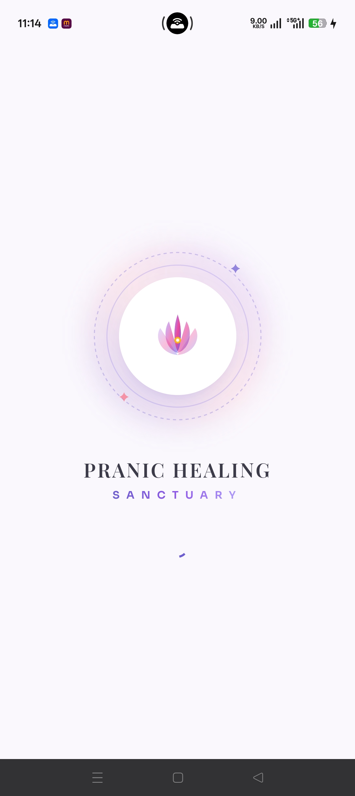 | 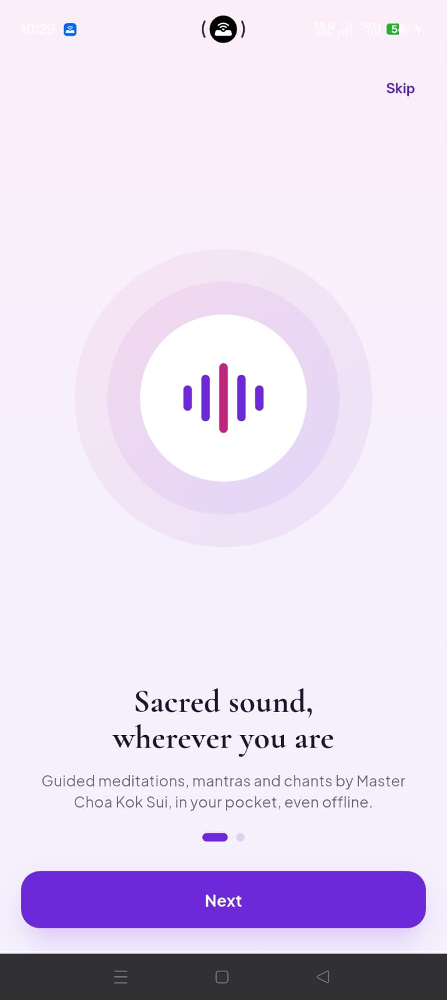 | 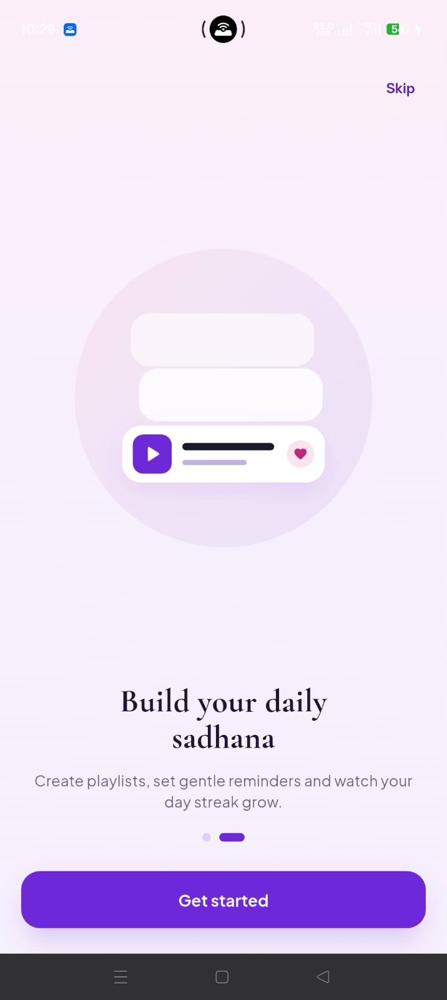 | 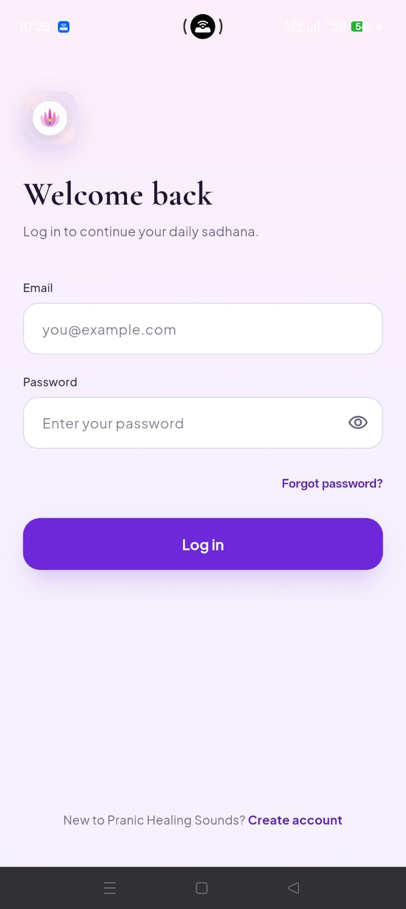 |

| Sign Up | Complete Profile | Home | My Albums |
| :---: | :---: | :---: | :---: |
| 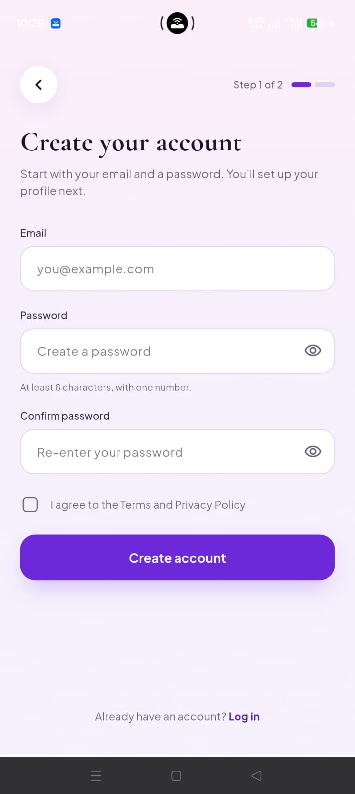 | 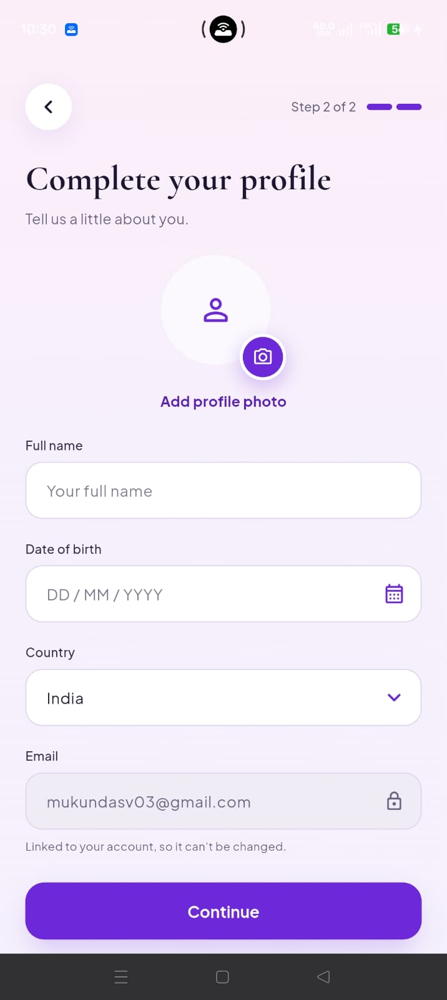 |  | 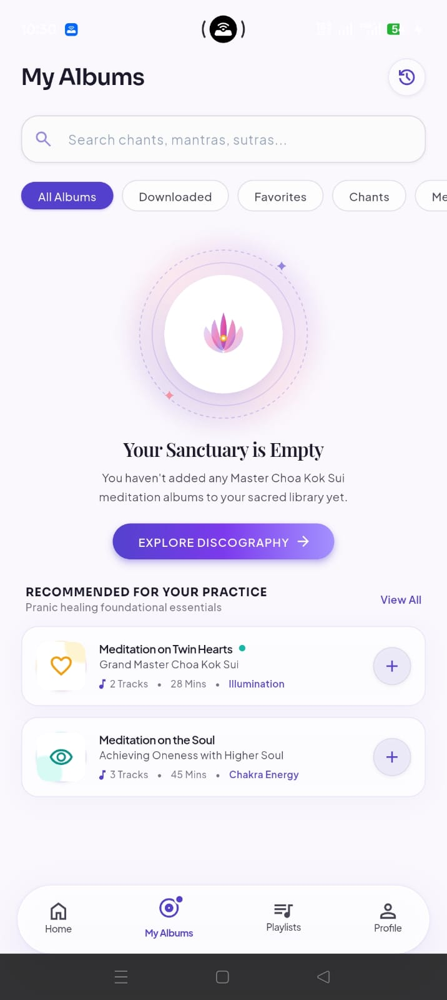 |

| Playlists | Profile | Settings | Logout |
| :---: | :---: | :---: | :---: |
| 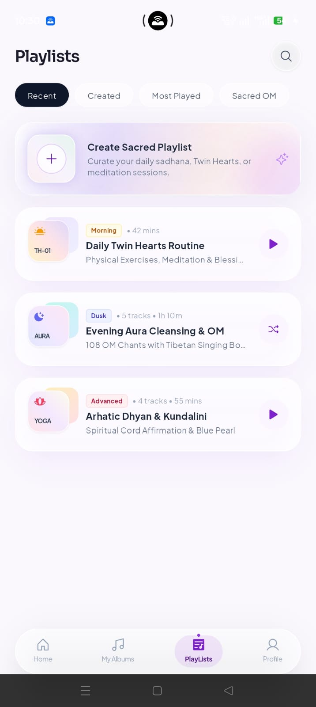 | 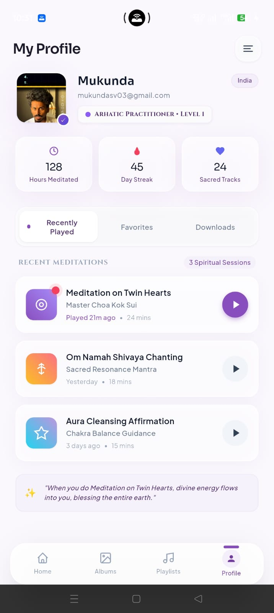 | 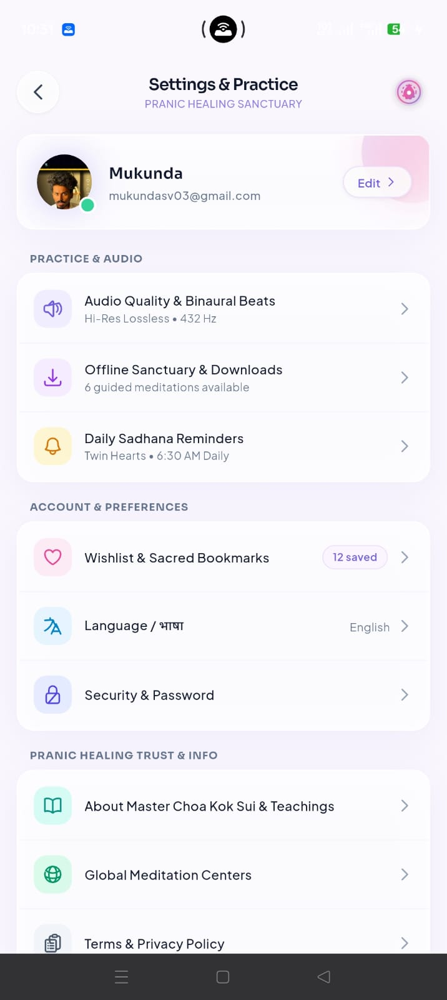 | 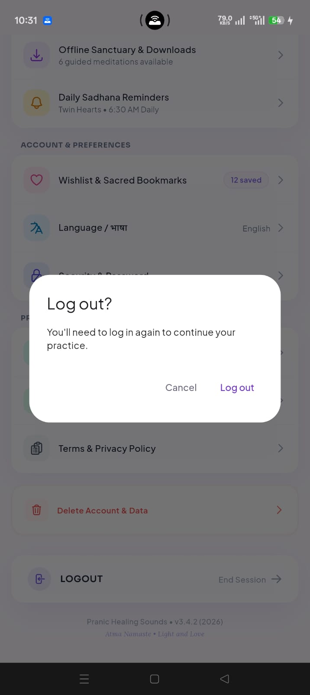 |

## Features

- Splash screen and two-step onboarding
- Email login and a two-step sign-up with profile setup
- Home with daily wisdom, a featured album, popular meditations and a mini player
- My Albums, Playlists and Profile tabs
- Settings with edit profile, logout and delete account

## Tech Stack

Flutter · Riverpod · Firebase Auth · Cloud Firestore · flutter_svg · google_fonts · image_picker · country_picker

## Project Structure

```
lib/
├── core/        # theme, shared widgets
└── features/    # splash, home, albums, playlists, profile, settings, player, shell
```

## Run Locally

```bash
git clone https://github.com/mukunda03/meditation_app.git
cd meditation_app
flutter pub get
flutter run
```

You'll need your own Firebase project. Add `google-services.json` to `android/app/`, then enable Email/Password Auth and Firestore.


## Author

**Mukunda** · [GitHub](https://github.com/mukunda03) · [LinkedIn](https://linkedin.com/in/mukundasv03)

