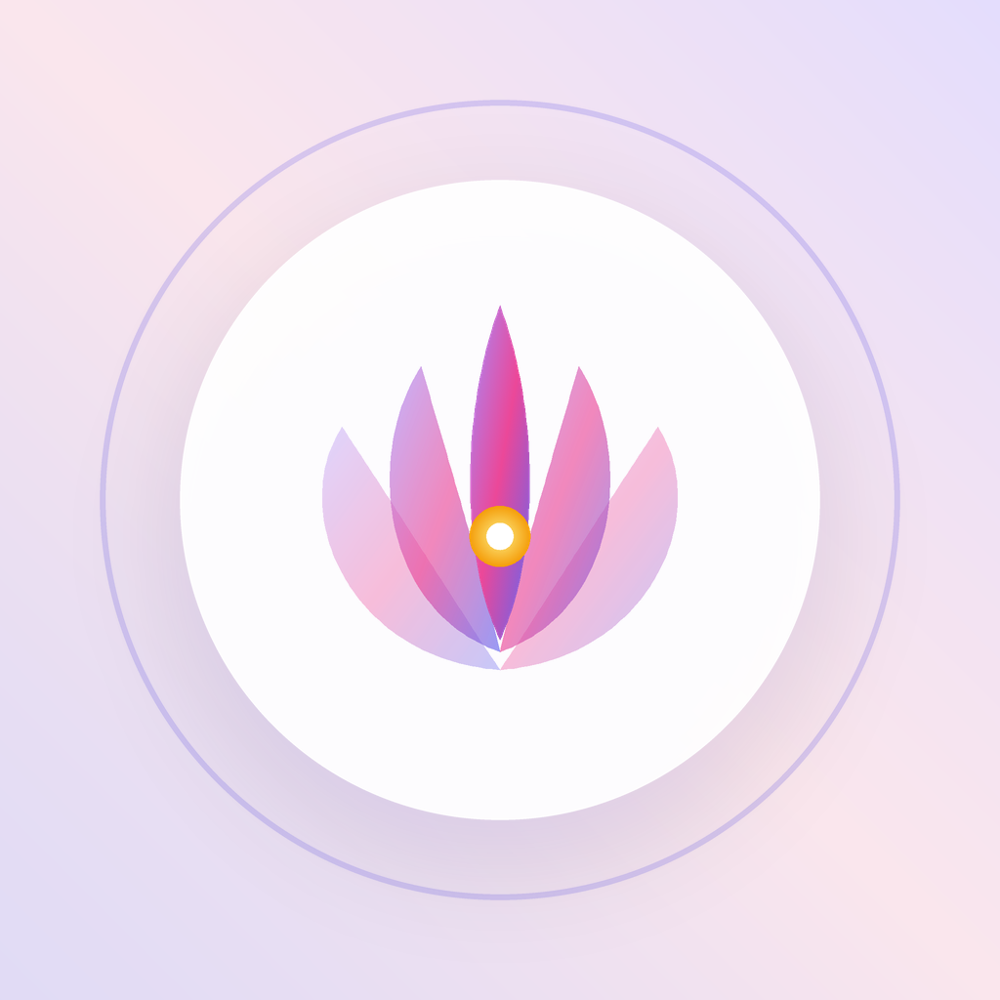
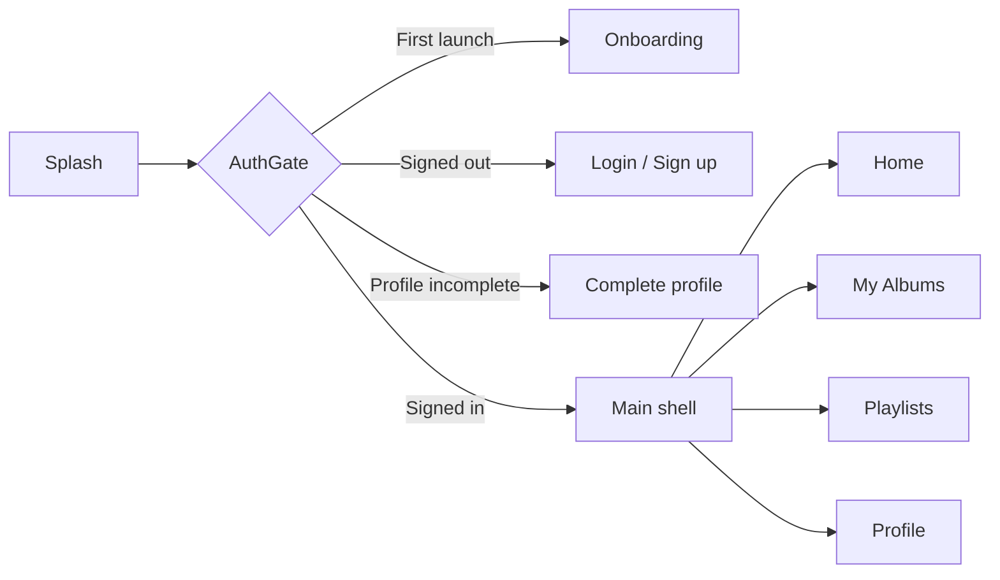

<div align="center">



# Pranic Healing Sanctuary

A meditation app built with Flutter from a Figma design, with Firebase authentication, live Firestore user profiles and Riverpod state management.

[](https://flutter.dev)
[](https://dart.dev)
[](https://firebase.google.com)
[](https://riverpod.dev)
[](#requirements)

[Download APK](https://github.com/mukunda03/meditation_app/releases) · [Screenshots](#screenshots) · [Getting started](#getting-started) · [Architecture](#architecture)

</div>

---

## Table of contents

- [Overview](#overview)
- [Screenshots](#screenshots)
- [Features](#features)
- [Tech stack](#tech-stack)
- [Architecture](#architecture)
- [Getting started](#getting-started)
- [Firebase setup](#firebase-setup)
- [Download](#download)
- [Roadmap](#roadmap)
- [Author](#author)

---

## Overview

**Pranic Healing Sanctuary** is a calm, minimal meditation app. The UI follows the original Figma design closely: glass-style cards, lotus motifs, a lavender palette and Plus Jakarta Sans typography.

Behind the UI, the app uses real Firebase email/password authentication and stores user profiles in Cloud Firestore, streamed live to the screen through Riverpod.

> **Note:** This project targets **Android only**. iOS and web are not configured.

---

## Screenshots

### Onboarding & authentication

| Splash | Onboarding | Login | Sign up |
|:---:|:---:|:---:|:---:|
|  |  |  |  |

### Main app

| Home | My Albums | Playlists | Profile |
|:---:|:---:|:---:|:---:|
|  |  |  |  |

### Profile & settings

| Complete profile | Edit profile | Settings |
|:---:|:---:|:---:|
|  |  |  |

<details>
<summary><b>Figma vs Flutter comparison</b></summary>
<br />

| Screen | Figma | Flutter |
|:---|:---:|:---:|
| Splash |  |  |
| Onboarding |  |  |
| Login |  |  |
| Sign up |  |  |
| Home |  |  |
| My Albums |  |  |
| Playlists |  |  |
| Profile |  |  |
| Settings |  |  |

</details>

---

## Features

**Authentication & onboarding**
- Animated splash screen, plus a native Android 12+ splash and adaptive launcher icon
- Onboarding shown only on first launch
- Sign up, login and forgot password with Firebase Auth
- Form validation and user-friendly error messages

**User profile**
- Complete-profile step: full name, date of birth, country and profile photo
- Profile stored in Cloud Firestore and updated live on screen
- Edit profile, including changing or removing the photo
- Logout, and account deletion with password re-authentication

**Meditation content**
- Home: featured album, meditation cards, wisdom banner and mini player
- My Albums with an empty state
- Playlists with filter chips and a create-playlist card
- Profile with practice stats, a daily quote and tabbed track lists
- Settings with grouped options

**Design**
- Built to match the Figma design
- Bottom navigation with a distinct dock style per tab

---

## Tech stack

| Category | Technology |
|:---|:---|
| Framework | Flutter (Dart `^3.13.4`) |
| State management | `flutter_riverpod` |
| Backend | `firebase_core`, `firebase_auth`, `cloud_firestore` |
| Local storage | `shared_preferences` |
| Media | `image_picker`, `flutter_image_compress` |
| UI | `flutter_svg`, `google_fonts`, `country_picker`, `calendar_date_picker2` |
| Tooling | `flutter_launcher_icons`, `flutter_native_splash`, `flutter_lints` |

---

## Architecture

The code is organised **by feature**. Each feature is split into three layers:

| Layer | Responsibility |
|:---|:---|
| `data` | Repositories that wrap Firebase (`AuthRepository`, `UserProfileRepository`, `AvatarRepository`) and models (`UserProfile`) |
| `providers` | Riverpod providers that expose repositories, auth/profile streams, form state and account actions |
| `presentation` | Screens (`ConsumerWidget`s) and reusable widgets |

Widgets never call Firebase directly. They go through providers and repositories.

### Project structure

```
lib/
├── main.dart              # Initialises Firebase and SharedPreferences
├── app.dart               # MaterialApp, theme and splash
├── core/
│   ├── firebase/          # Firebase error → readable message
│   ├── providers/         # Firebase and SharedPreferences providers
│   ├── theme/             # AppColors, AppTheme
│   └── widgets/           # Shared widgets (GlassCard, AppSnackBar, ...)
└── features/
    ├── splash/
    ├── onboarding/
    ├── auth/
    ├── profile/
    ├── home/
    ├── albums/
    ├── playlists/
    ├── player/
    ├── settings/
    └── shell/             # Bottom navigation shell
```

### App flow



`AuthGate` listens to the auth and profile streams, so logging in or out automatically shows the right screen. No manual navigation is needed.

---

## Getting started

### Requirements

| Tool | Version |
|:---|:---|
| Flutter SDK | Stable channel, Dart `^3.13.4` |
| Android SDK | With platform-tools |
| JDK | 17 or newer |
| Device / emulator | Android 5.0 (API 21) or newer |

### Installation

```bash
# Clone the repository
git clone https://github.com/mukunda03/meditation_app.git
cd meditation_app

# Install dependencies
flutter pub get

# Run on a connected device or emulator
flutter run
```

The repository already includes `android/app/google-services.json`, so the app connects to the existing Firebase project with no extra setup.

### Build a release APK

```bash
flutter build apk --release
```

The APK is written to `build/app/outputs/flutter-apk/app-release.apk`.

### Regenerate the icon and splash

Only needed after changing images in `assets/branding/`:

```bash
dart run flutter_launcher_icons
dart run flutter_native_splash:create
```

---

## Firebase setup

To use your own Firebase project instead of the included one:

1. Create a project in the [Firebase console](https://console.firebase.google.com/).
2. Add an Android app with the package name `com.indoss.meditation_app`.
3. Download `google-services.json` and place it in `android/app/`.
4. Enable **Email/Password** under *Authentication → Sign-in method*.
5. Create a **Cloud Firestore** database.
6. Add these security rules:

```
rules_version = '2';
service cloud.firestore {
  match /databases/{database}/documents {
    match /users/{uid} {
      allow read, write: if request.auth != null && request.auth.uid == uid;
    }
    match /avatars/{uid} {
      allow read, write: if request.auth != null && request.auth.uid == uid;
    }
  }
}
```

### Data model

| Collection | Document ID | Fields |
|:---|:---|:---|
| `users` | Auth `uid` | `uid`, `email`, `fullName`, `dateOfBirth`, `countryCode`, `countryName`, `profileCompleted`, `createdAt`, `updatedAt` |
| `avatars` | Auth `uid` | `photo` (compressed 256px JPEG Blob, under 700 KB) |

Profile photos are stored as Firestore Blobs instead of Firebase Storage, so the project runs on the free Spark plan.

---

## Download

Get the latest `app-release.apk` from the [Releases page](https://github.com/mukunda03/meditation_app/releases).

Copy it to an Android phone (Android 5.0 or newer), open it, and allow **Install unknown apps** when prompted.

---

## Roadmap

- [x] Firebase authentication and user profiles
- [x] All Figma screens implemented
- [x] Native splash screen and adaptive launcher icon
- [ ] Audio playback (content and mini player are UI only for now)
- [ ] Save albums and playlists to Firestore
- [ ] Working settings (reminders, downloads, language)
- [ ] Automated tests
- [ ] Release signing for the Play Store
- [ ] iOS support

---

## Author

**Mukunda SV**

- GitHub: [@mukunda03](https://github.com/mukunda03)

If you found this project useful, consider giving it a ⭐
